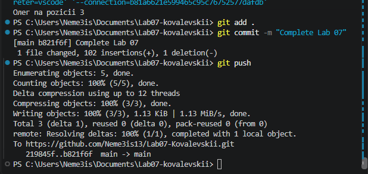

# Практическая работа №7
**Ковалевский Алексей**
**ИСП-243**
**02.11.2026**
## Что изучено
- хранить набор однотипных значений в одном массиве;
- получать и изменять элементы по индексу;
- перебирать массив черезfor и foreach;
- решать типовые задачи: сумма, среднее, минимум/максимум,      подсчёт по условию.
